

  
  <h2>玄镜 AegisScope V2.3.5</h2>
  
前端资产采集与安全审计浏览器扩展

## 项目简介

玄镜 AegisScope 是一款用于授权安全测试的 Chrome / Edge 扩展，主要处理网站前端资产的采集与分析。从当前页面出发，可以保存 HTML、JavaScript 和 SourceMap，识别网站技术栈，检查源码中的敏感信息、加密参数和接口风险，并查看 Vue / React 的运行时实例与路由。

各模块围绕同一个目标标签页工作，采集到的资源可继续用于泄露扫描和漏洞审计，识别到的框架可直接进入对应控制台。扫描结果保留来源、命中位置和检测依据，方便回到源码与请求中核查。插件同时提供备案查询、主动指纹扫描、API 批量测试，以及解除复制、WebRTC 防护、UA 和编码修改等辅助功能。

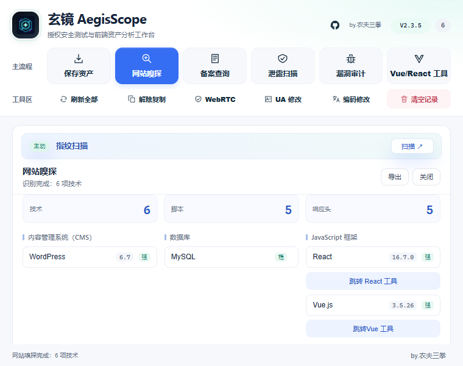

## 免责声明与使用许可

首次打开插件时，需阅读并同意免责声明后，插件功能才会启用。

本工具禁止用于未授权目标，也禁止二次开发后用于未授权用途。

本插件具备代码资产采集、网站嗅探、备案查询、指纹扫描、泄露扫描、漏洞审计、API 探测、浏览器辅助、路由运行时分析等能力。使用过程中可能对目标网站造成**访问日志增加、接口请求增加、触发风控告警、触发验证码或登录失效、造成业务状态变化、业务状态不可用**等风险。**代码资产中可能存在敏感信息，禁止未授权下载保存代码资产**，请仅在测试环境或明确授权范围内使用，您在使用本插件的过程中存在任何非法行为，您需自行承担相应后果，我们将不承担任何法律及连带责任。

在执行 API 批量测试、漏洞验证、POST/PUT/PATCH/DELETE 等请求方法、路由守卫绕过或任何可能改变业务状态的操作时，可能导致**数据变更、数据误删除、审计日志产生、告警触发、权限状态异常或业务流程被干扰**。请仅在测试环境或明确授权范围内使用。

## 安装与更新

1. 解压 `玄镜 AegisScope_V2.3.5.zip`。
2. 打开 Chrome / Edge 扩展管理页，启用“开发者模式”。
3. 选择“加载已解压的扩展程序”，指向包含 `manifest.json` 的目录。
4. 打开插件，确认版本号为 **V2.3.5**，阅读并同意使用说明。

**更新已有安装：** 覆盖原加载目录后，点击扩展管理页的“重新加载”。如果使用新的版本目录，需要重新加载该目录并停用旧版本。更新后关闭旧工具页，从插件重新打开。

**刷新数据：** 首页“刷新全部”重新采集资产，并刷新当前显示的嗅探或备案面板。泄露扫描、漏洞审计和框架控制台是独立页面，使用各自的扫描或分析按钮。

目标页需要是浏览器可以正常访问的 HTTP/HTTPS 页面。浏览器内置页、扩展页和证书拦截页无法按普通站点分析；Vue/React 实例则需要等应用挂载后才能读取。

## 功能

### 保存资产

“保存资产”提供两种输出：

- **代码资源包**：将页面 HTML、内联和外链脚本，以及发现的 chunk、SourceMap、框架资源打包为 ZIP。
- **单文件页面**：将能够读取的页面资源内联到 HTML，保存当前页面快照。

页面内容从目标标签页采集，外链资源由扩展读取。请求会按目标主机尝试携带 Cookie，不会复制页面自定义的认证头。需要额外认证的资源可能下载失败；单文件快照也不能替代后端服务，离线时依赖接口的功能通常不可用。

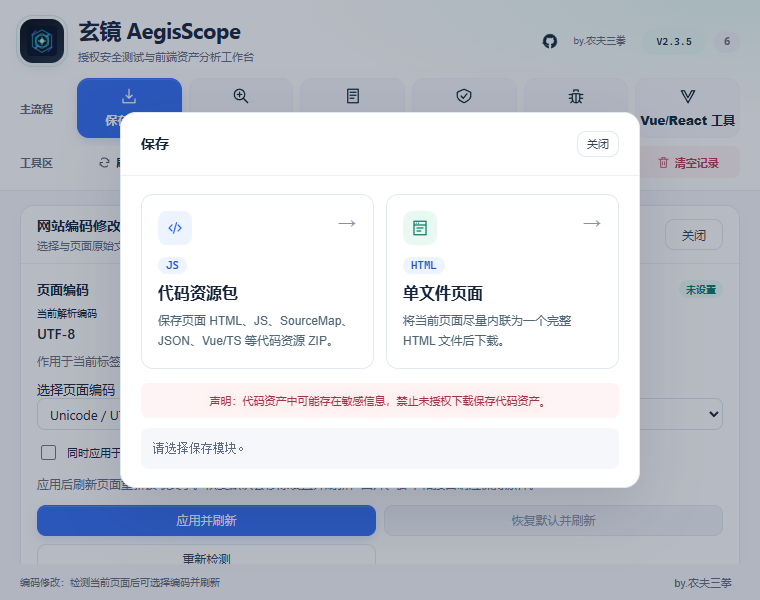

### 备案查询

从当前页面正文、源码和链接中提取 ICP 备案号、公安备案号、许可证及相关链接，结果直接显示在弹窗内。

第三方接口结果作为补充，缓存一天。接口不可用不影响页面提取结果；备案信息以对应主管部门的查询结果为准。

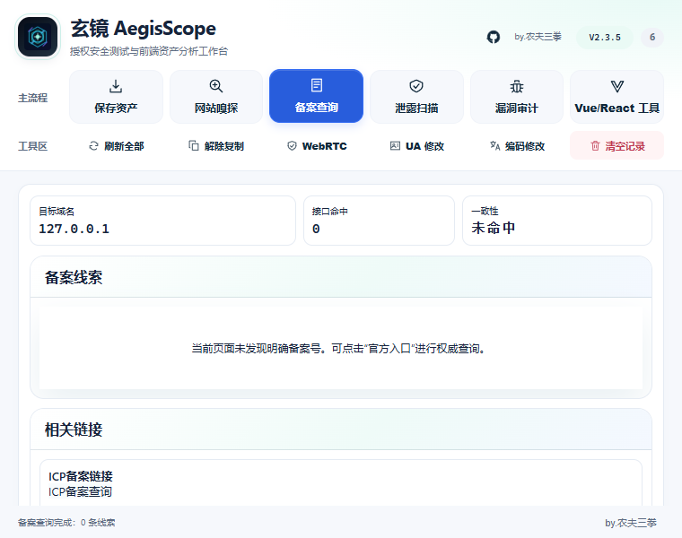

### 网站嗅探

根据 HTML、响应头、Cookie、脚本、资源路径和运行时对象识别技术栈，包括 CMS、前端框架、JavaScript 库、UI 组件、CDN 等。识别到 Vue.js、React 或 jQuery 后，结果下方会显示对应工具入口。

结果分阶段更新。出现“部分完成”时，展开“采集范围说明”查看未覆盖的内容。嗅探结束后有两次延迟复查，用于补采晚加载的页面信号；关闭弹窗即停止复查。

检测方式与限制

- React 通过挂载根节点和 Fiber 识别，不依赖全局 `React` 变量。支持开放 Shadow DOM；空 Devtools 钩子不计为已挂载实例。
- DOM 规则同时检查节点及其属性或文本。通用标签、静态目录不单独作为产品证据，同一条件重复命中不重复计分。运行时版本优先于文件名推测，依赖关系、互斥条件和关联推断分别处理。
- 规则在 Worker 中运行，分析预算为 5 秒；超时保留已完成结果。重复刷新合并执行，缓存只复用已完成的分析，页面变化后丢弃旧任务结果。
- DOM、正文和样式采用有限采样，读取属性时跳过 getter。未加载代码、封闭 Shadow DOM 和采样范围外的特征可能漏检。
- 扩展规则包含此前补充的 215 项被动检测条件，另有 93 项关联推断目录。请求路径仅使用浏览器已观察到的请求；嗅探不主动探测 DNS、证书或额外路径，也不下载所有外部脚本。

#### jQuery 低版本验证

从嗅探结果进入验证页，选择候选 jQuery 核心库，也可以手动填写库地址。库文件在独立沙箱内加载，验证的是所选库在测试用法下的行为。目标网站是否受影响，还取决于它实际如何调用该库。

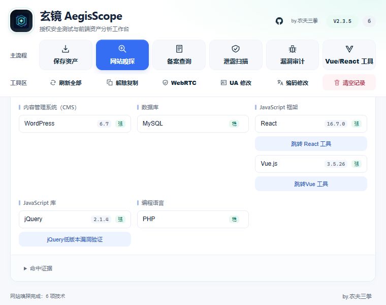

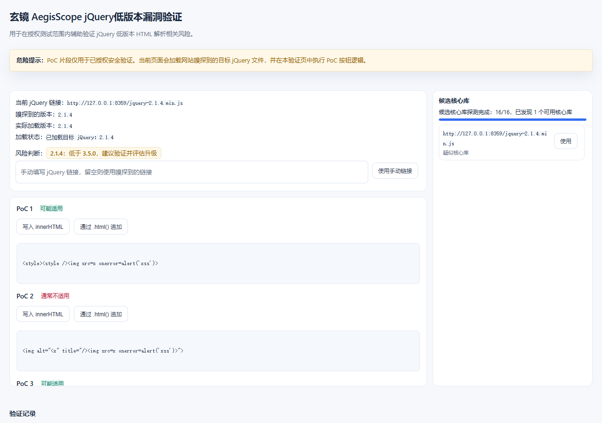

### 指纹扫描

从网站嗅探进入，打开后自动扫描。与被动嗅探不同，指纹扫描会请求部分静态资源和常见产品路径，再结合响应头、标题、正文、图标 Hash 等条件匹配产品。

规则库包含 1.1 万余个产品指纹、2.2 万余个匹配器。结果列出产品、分类、置信度、状态码、响应长度、标题和命中证据。

| 扫描模式 | URL 上限 | 静态资源选取上限 | 请求并发 |
| --- | --- | --- | --- |
| 默认 | 56 | 14 | 2 |
| 扩展扫描 | 168 | 56 | 2 |

“扩展扫描”会重新开始任务。停止后保留已读取内容的分析结果，失败、截断及未请求的范围会一并显示。

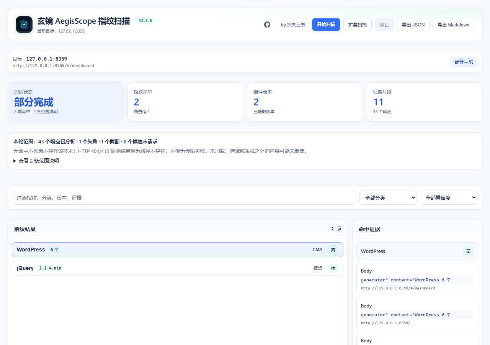

### 泄露扫描

检查当前页面 HTML、已发现的脚本、代码依赖和 JSONP 响应，提取凭据、个人信息、加密参数及危险代码用法。结果按风险等级排列，并保留源码位置和引用证据。

常量追踪可以处理压缩后的短变量名、变量别名和静态配置对象，用于定位传入加密接口的 key、IV 等参数。它只做静态分析，不执行目标代码，也不会拿检测出的凭据访问服务。登录后返回当前用户自己的资料，需要结合接口权限判断，不能仅凭手机号或身份证号命中认定越权。

默认单资源读取上限为 **8 MiB**，扩展扫描为 **32 MiB**。读取失败、截断或跳过时，查看覆盖说明。

规则范围与读取限制

- 常规规则覆盖云密钥、Token、Cookie 凭证、Webhook、邮箱、手机号、身份证号、银行卡号、IP，以及弱加密、危险解码执行和打包/混淆特征。
- 加密参数追踪覆盖 CryptoJS 风格的 AES、DES、TripleDES、RC4/RC4Drop、Rabbit/RabbitLegacy、HMAC、PBKDF2/EvpKDF，常见 SM4、SM2 私钥调用，以及 Node crypto 风格接口和 Web Crypto 静态密钥导入。
- 支持同库 Utf8/Hex/Base64/Latin1 解析、部分 `Buffer.from`、`TextEncoder` 和常量字节数组；Web Crypto 可追踪 raw/PKCS#8 及 JWK 秘密字段。公钥、普通哈希消息不计为秘密材料，固定盐值单独列为信息项。
- 追踪限于单文件，无法确定的动态值、跨文件引用和复杂混淆不继续推断。源码长度上限为 8 × 1024 × 1024 个 UTF-16 代码单元，另有 30 万语法节点和遍历时间限制。这些预算不随扩展扫描提高；追踪失败不影响其他规则执行。解析器许可见 [Acorn LICENSE](scripts/lib/acorn-LICENSE.txt)。
- JSONP 使用已发现或后台已记录的资源，要求带有效 `callback`、`jsonp` 或 `jsonpcallback` 参数。已知非 GET 请求及可识别的退出、删除等操作地址不自动重放。
- 扩展读取失败时，可在同源目标页面内携带 Cookie 重试一次。重试不跟随重定向、不复制自定义认证头，仍受体积与超时限制。页面变化或停止扫描会终止读取；本功能不会持续录制全部接口响应。

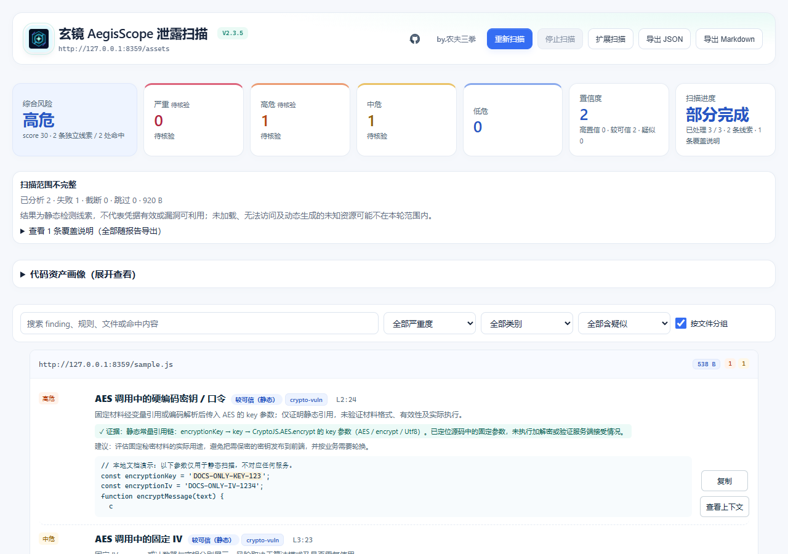

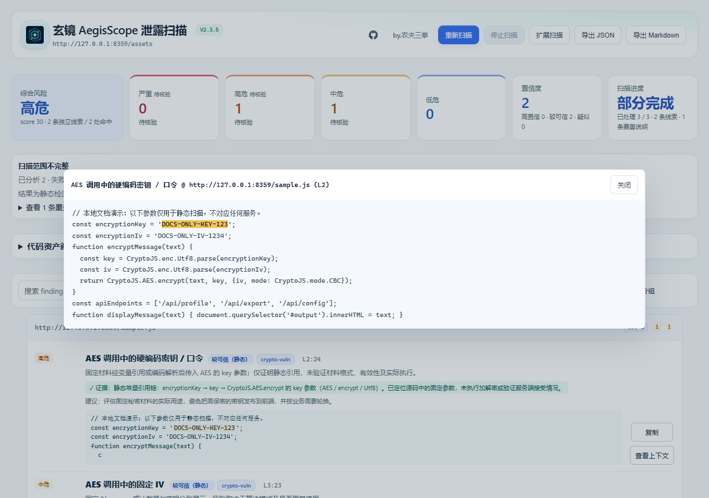

### 漏洞审计

从源码、代码依赖和 SourceMap 中查找接口与风险用法，不自动遍历普通业务链接。主要检查接口文档暴露、客户端鉴权、对象或租户标识可控、支付参数，以及 DOM XSS、开放重定向、上传校验、CSRF、CORS 等问题。

有内置验证流程的条目提供“验证”按钮，执行时可能发送请求；依赖业务上下文的条目标记为“人工复核”。命中源码特征只是检查起点，最终结论需要看返回内容、账号权限和业务行为。

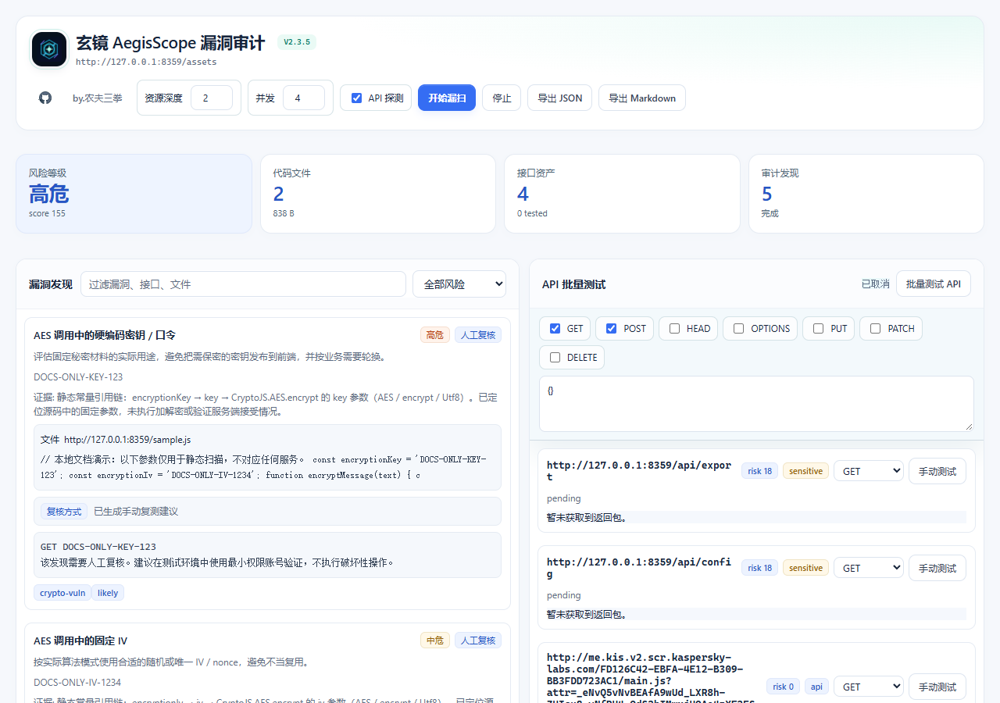

### API 批量测试

位于漏洞审计页。选择请求方法、填写请求体后执行，支持 GET、POST、HEAD、OPTIONS、PUT、PATCH、DELETE，也可单条手动测试。批量任务每轮最多处理 160 个同源地址，跳过可识别的退出、删除等操作地址。

每个接口分别发送允许携带 Cookie 和省略 Cookie 的请求，展示状态及响应预览。界面的“登录态”不代表认证一定成功：插件不复制页面的 Authorization 等自定义头，Cookie 也受浏览器策略限制。响应预览会截断，HTTP 200 本身不能证明未授权访问成立。

POST、PUT、PATCH、DELETE 等方法执行前需要确认，可能改变业务数据。操作类接口如需测试，使用单条手动入口。

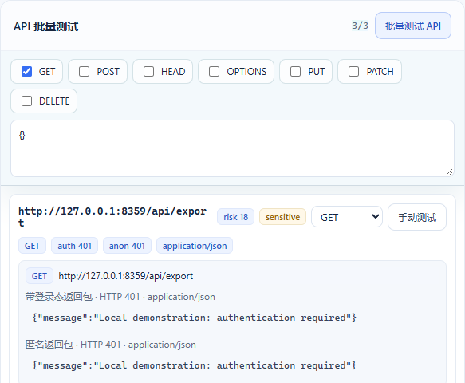

### Vue/React 工具

首页“Vue/React 工具”默认进入 **玄镜 AegisScope Vue 控制台**。从嗅探结果点击 React 入口，则进入 **玄镜 AegisScope React 控制台**。两页顶部可互相切换。

#### React 运行时分析

读取页面暴露的 React 版本、挂载实例和路由配置，另列同源链接。支持筛选、JSON 导出和打开地址；动态参数路径不提供直接打开。未读到版本或路由时，页面会显示相应状态。

“打开”使用浏览器正常导航，访问权限由网站处理。控制台保持打开时，目标页同源跳转、刷新后仍保留列表，但标记为上次采集结果；需要更新时点击“分析实例”。跨源、关闭目标页或重新打开控制台会清除旧列表。分析等待超过 12 秒会超时退出，按钮恢复可用。

路由来源与快照

- 从 Fiber props、JSX 子节点、Context 和组件 props 中读取路由，支持旧版 `childRoutes`。菜单和链接另行标注，不计入路由配置数量。
- DOM、Fiber、配置读取分别限制预算。未加载路由、封闭 Shadow DOM 和其他 iframe 不在采集范围内；Hash/History 和 basename 生成的地址应与实际部署核对。
- 导出 JSON 的 `snapshot` 记录采集地址、当前地址、时间和过期状态。同源要求协议、主机、端口相同。分析期间导航会取消当前任务，旧任务返回不会覆盖新结果。

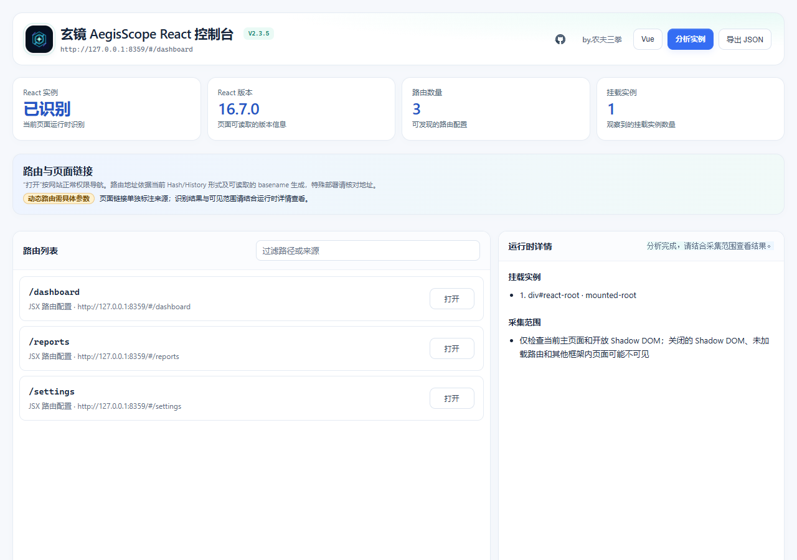

#### Vue Router 分析

读取 Vue / Vue Router 实例、路由表、meta 和守卫信息。存在多个路由器时先选择实例；动态路由填写参数后再跳转。父级布局的入口重定向不会直接阻止子页面跳转。

Vue 控制台在目标页同源跳转、刷新后清除旧结果并自动分析。切换到其他源，或应用尚未挂载时，等页面就绪后点击“分析实例”。Hash 路由导出保留入口文件和查询参数。

跳转后立即回到登录页时，可在授权测试中开启“授权增强模式”重试；“恢复”会取消当前导航并清理增强状态。跳转成功只说明前端视图已通过本次检查，后端接口仍按原有权限处理。

跳转检查与恢复

- Vue Router 4 普通导航未到达目标时，可走运行时兼容导航。重定向只检查最终匹配记录，同时保留重定向解析、循环检测和组件挂载检查。
- 结果确认同时检查路由状态、浏览器地址和组件挂载，并观察约 0.7 秒。之后再次跳转或刷新，上一条结果即失效。
- 增强模式在本次跳转确认期间临时处理竞争导航，结束后恢复普通导航方法。关闭增强时恢复暂停的守卫，已取消注册的守卫不会重新加入；启用失败会提示并尝试回滚。该模式不提供登录凭据，也不改变后端权限。
- 同一文档复用分析辅助脚本，新文档重新安装。晚挂载应用会短暂重试，已卸载实例不会自动替换成另一个实例来操作。

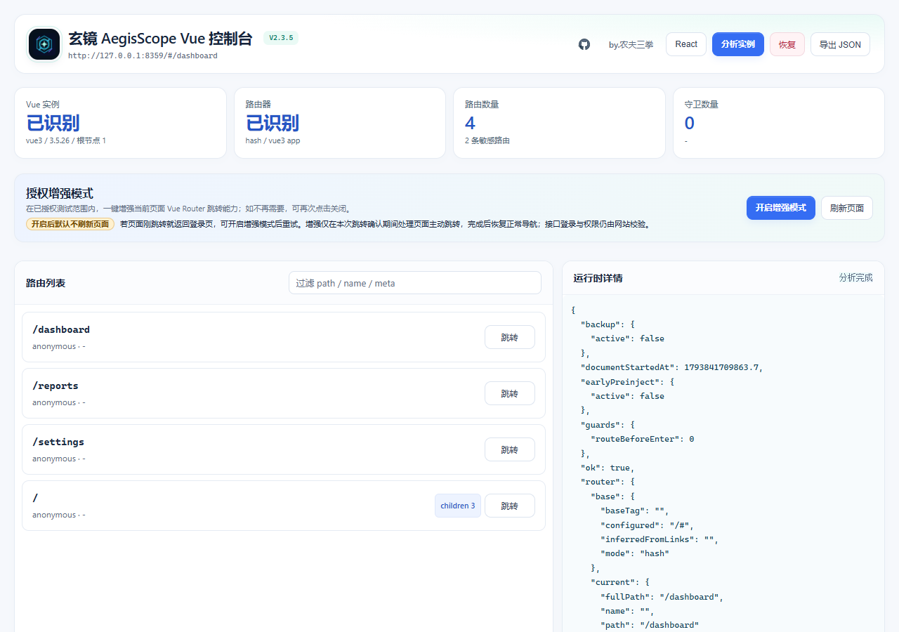

### 浏览器辅助

**解除复制**：临时解除页面的选择、复制、右键、快捷键和粘贴限制。可以先启用再选择文字；勾选当前域名自动启用后，刷新页面仍会应用。部分文库和在线文档有专门适配。

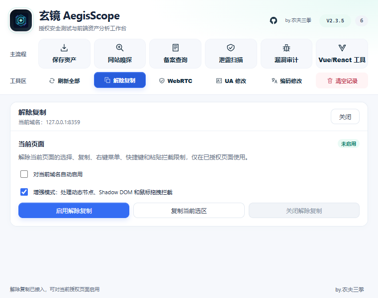

**WebRTC**：提供浏览器隐私策略和页面级强阻断，用于限制本机网络地址暴露。强阻断会影响依赖 WebRTC 的视频、语音和在线客服功能。

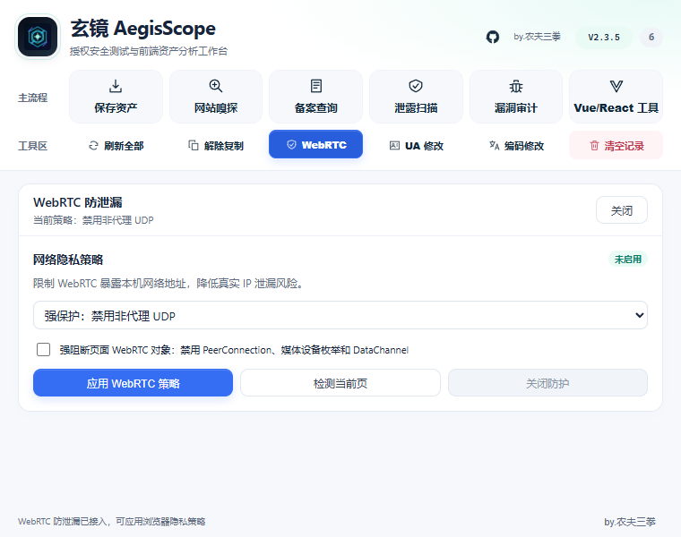

**UA 修改**：切换页面 User-Agent，内置 66 个预设，包含桌面、移动端、App 内置浏览器及搜索爬虫。

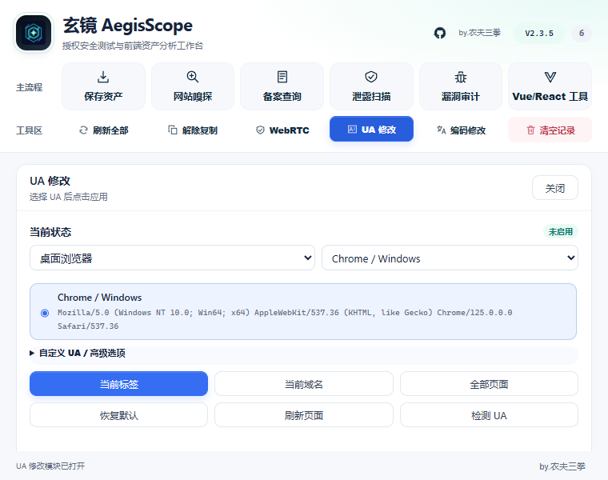

**编码修改**：检测页面当前编码，应用指定编码后刷新；支持恢复默认及本站 iframe，适用于 HTTP/HTTPS 的 HTML、纯文本和 XML 页面。

新版 Chrome/Edge 按当前标签页的网站生效。旧版浏览器使用地址兼容模式，仅覆盖当前地址和已勾选、已识别的本站 iframe；打开其他地址或新增 iframe 后需要重新应用。同一地址返回的文档类型变化时，先恢复默认。设置在关闭标签页或结束浏览器会话后清除。

BOM 或 Service Worker 缓存可能影响解码结果，以面板检测到的实际编码为准。

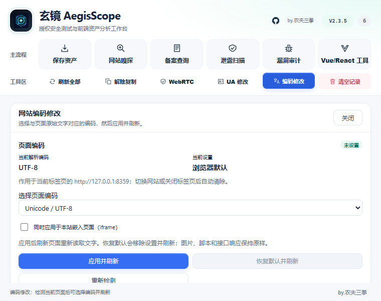

## 第三方参考与许可

编码修改参考 Chrome-Charset 的响应头处理方式，按本扩展的后台状态和界面独立实现。原项目作者为 Liming Jin，采用 MIT 许可，见 [Chrome-Charset LICENSE](docs/third-party/Chrome-Charset-LICENSE.txt)。

## 版本记录

以下为各版本的变更记录。当前操作方式以本文功能说明为准。

### V2.3.5

- 新增 React 控制台：查看版本、挂载实例、路由和同源链接，支持筛选、JSON 导出及正常导航。首页入口改为“Vue/React 工具”，默认打开 Vue 控制台。
- 补充 React Stack、Fiber 和 renderer 识别，统一 React、Vue 控制台的字体、配色和布局。
- 扩展 React 路由读取：支持 JSX 嵌套配置、路径数组、旧版 childRoutes、Context 和组件 props。菜单、链接及静态 to/from 地址单独标注，修正挂载根重复计数、路由模式和基础路径继承。
- 修复 History 地址中的 `#` 被编码为 `%23`，区分 URL 片段与字面编码路径。
- 修复 React 分析长时间不结束：分阶段限制 DOM、Fiber 和配置读取，改用消息任务调度，增加总耗时限制及控制台 12 秒超时恢复；导航、关闭和迟到结果均按任务状态处理。
- React 工具在同源跳转、刷新后保留已采集列表和筛选条件，允许连续打开地址；跨源或关闭目标页时清理，导出附带快照状态。
- Vue 跳转后自动分析复用辅助脚本和路由发现结果，同源页面变化合并处理，晚挂载时短间隔重试；保持原有列表清理方式。
- 修复 Vue 兼容导航误将父布局重定向当作子页面重定向的问题，改为检查最终匹配记录，保留循环检测和视图挂载确认。

### V2.3.4

- 修复嗅探覆盖不完整时仍显示“识别完成”、未完成分析被当作完整结果复用，以及技术列表不变时采集范围说明未更新的问题。
- 网站嗅探改用独立工作线程，增加初步结果、超时覆盖说明、任务取消、重复刷新合并和未变化信号复用，减少大页面识别时的弹窗卡顿。
- 修复部分未命中特征的正则在长 HTML/脚本上的耗时问题；补充 215 项被动技术检测条件及遗漏的 Cookie、响应头和请求路径规则，保持依赖关系与误报过滤。
- 修复重复页面加载通知清空已收到响应头的问题；新页面开始请求时重置记录，丢弃旧页面迟到的资源结果，保留当前页面的 JSONP 采集。
- 将 AES 常量引用追踪扩展到常见对称算法、HMAC、密钥派生及私钥导入/使用接口；增加 Web Crypto、Node crypto 风格调用和国密常见调用的参数定位，分别标记秘密材料与非秘密参数。
- 过滤公钥导入、普通哈希消息及可识别的随机化/变更字节数组反例，固定盐值不再与签名秘密重复计高风险；保留源码定位、用途与导出证据。
- 修复扩展规则中的版本/置信度元数据、结构化 DOM 条件和空值存在性判断；补齐部分遗漏运行时条件、分类依赖与传递推断处理。
- 修复同一特征重复计分、文件名版本覆盖运行时版本、延迟加载后页面信号陈旧的问题；加强通用 CSS 路径误报过滤、可见正文与样式采样，更新嗅探缓存格式。
- 修复压缩脚本通过短变量名和编码解析传递 AES key / IV 时的漏报，支持同文件作用域、变量别名和静态配置对象；补充源码位置、加解密用途及导出证据。
- 避免把注释、源码字符串、同名跨模块变量、遮蔽变量、动态赋值和密文参数当作已追踪密钥；保留解析失败、预算不足的覆盖提示。
- 修复 React 打包页面未暴露全局变量时的识别遗漏，补充真实挂载根节点及 Fiber 特征采集，支持开放 Shadow DOM、延迟挂载与卸载后的结果刷新。
- 恢复 React、SummerCart、Pleroma 规则中指定 DOM 节点与属性/文本的关联条件，避免将节点存在等同于技术存在。
- 排除通用 HTML 标签和选择器对识别分数的贡献，修复普通页面被误报为 SummerCart、Pleroma 的情况；移除通用静态目录单独触发 EmpireCMS、PHPCMS 的规则。
- 修复普通 class 属性或常规 CSS 链接被误当作 Tailwind CSS 特征的问题，保留具体 CSS 特征和明确产品链接的识别。
- 运行时读取跳过属性 getter，限制节点和时间预算，保留采集范围说明；继承 V2.3.3 的 Vue、jQuery 验证页及 JSONP 泄露扫描修复。

### V2.3.3

- 修复非 `.js` 后缀的 JSONP 资源漏采集，例如通过 XMLHttpRequest / Fetch 加载的 `loginInfo.rst?callback=…`；补充后台已观察资源记录。
- 增加资源读取失败后的同源页面内重试，沿用当前登录 Cookie；补充停止、同地址刷新、文档变化和读取来源导出处理。
- 修复手机号附近出现 `.test()`、`latestVersion` 等普通代码时被误过滤；示例标记降级保留为疑似线索。
- 完善多路由实例选择、晚挂载等待和异常实例容错；修正仅存在 Devtools 钩子时的 Vue 误报，以及根路由显示成正则表达式的问题。
- 修复增强期间新注册守卫丢失、方法属性恢复不完整和残留定时器；支持反复开关、页面挂起恢复，保留随后由其他工具替换的方法。
- 页面变化时清除旧路由列表，按浏览器文档标识执行操作；修复 Hash 导出地址遗漏入口文件与查询参数，增加增强启用失败回滚。
- 修复 Vue 工具显示“已跳转”，但页面随后返回登录页的问题。结果确认同时检查路由状态、浏览器地址及目标组件挂载，并等待短暂稳定；之后发生地址变化或刷新时，旧结果自动失效。
- 完善授权增强模式：在用户主动发起的本次跳转确认期间，临时处理组件初始化等逻辑发起的竞争导航；结束、失败、超时、用户操作或恢复时撤销临时处理，保留正常导航方法。
- 为 Vue 2 Hash 路由补充同文档地址兼容导航，兼容部分脚本将 push 替换为空操作的情况；保留 index.html 等入口路径和原有查询参数。
- 完善运行时恢复、重复点击控制、目标标签关闭提示与扩展更新后的旧辅助脚本替换；延续 V2.3.2 的 jQuery 验证页首次打开修复。

### V2.3.2

- 修复点击“jQuery低版本漏洞验证”后首次打开白屏、需要刷新才能显示的问题：验证页只导航一次，避免内嵌沙箱页面重复加载。
- 改为等待验证界面初始化完成后加载目标 jQuery，避免首次启动或慢加载时丢失状态与源码消息。
- 增加加载提示及超时后的重新打开入口；目标库下载失败时仍保留验证界面和手动填写链接的功能。

### V2.3.1

- 统一主弹窗与各工具页的清亮蓝、薄荷青浅色界面，补齐导航图标、选中/禁用/键盘焦点状态和风险等级配色；优化弹窗滚动、窄窗口布局及路由列表间距。
- 网站嗅探会核验当前页面，修复同地址缓存陈旧、延迟信号混入其他页面的问题；过滤仅由通用 HTML 标签或选择器产生的技术误报。
- 指纹重复弱特征不再跨 URL 累加置信度；停止后完成已读取内容的分析，失败与截断同步显示在页面及导出报告中。
- 指纹扫描增加扩展扫描、双请求并发与总时间预算，规则准备和匹配分片执行；自动资源采集跳过普通业务链接。
- 修复审计空队列无法结束、普通业务链接被自动请求、鉴权失败响应被误判为已确认漏洞的问题。
- 增加后台采集记录的有容量限制的会话恢复，修复单文件 HTML 编码声明不一致导致的乱码。
- 修复目标切站后的工具状态同步、UA 应用失败后的状态回滚，以及 WebRTC 强阻断自检误报。

- 完善编码修改功能：检测页面实际编码，支持常见中文、日文、韩文及其他编码，应用后刷新，支持恢复默认。
- 编码设置限定当前标签页，支持本站 iframe；旧版浏览器自动切换为当前页面地址兼容模式，支持刷新保留和恢复默认。
- 修复保存资产弹窗底部提示栏背景过暗、文字不清晰的问题。

#### 泄露扫描修复

- 使用原始代码检测，保留完整命中内容和原始行列位置；不再通过插入换行美化扫描输入。静态规则的高置信命中不等于凭据有效或漏洞可利用。
- 扫描当前页面、可访问框架、已采集脚本和发现的代码依赖；支持 SourceMap 响应头、内联 base64/URI 映射、分段映射、sourceRoot 及可获取的缺失源码。历史内联脚本单独标注采集快照来源。
- HTTP 失败、超时、登录 HTML、编码异常、截断与数量上限均在覆盖说明和报告中显示。带查询参数的资源失败时保留原地址，不再删除参数后扫描另一个版本；重定向保留请求和响应两个地址。
- 普通扫描上限：单文件 8 MiB、总内容 96 MiB、2400 个资源、20000 处命中、每条规则每文件 1000 处；“扩展扫描”重新扫描当前页面，提高到 32 MiB、384 MiB、9600 个资源、50000 处命中、每规则 5000 处。达到上限明确提示，不能解释为无风险。
- 规则分析运行于独立 Worker；可停止扫描、终止请求和分析线程，页面跳转自动结束旧扫描。文本全文不长期保存在结果中，界面分批显示，JSON/Markdown 导出全部已保留的命中及覆盖信息，不受界面过滤条件影响。
- 公开客户端配置、IAM 实体标识符、anon 角色和明确示例标记降级为待核验线索；风险评分按同规则相同完整命中去重，仍保留每处来源。默认显示全部置信度。

“完成”只表示本轮发现的资源处理完成，不保证发现站点的全部未知资源。未加载的动态代码、复杂混淆、运行时拼接、无法访问的资源及浏览器不允许读取的页面仍可能需要人工补充。扫描不会使用发现的凭据请求云服务验证；本地样例回归不能换算为所有网站的准确率或召回率。

### V2.2.9

- 修复解除复制需先选择文字、动态页面生效不稳定的问题；支持直接启用后选择文字复制，增强样式优先级与页面重绘后的恢复。
- 修复解除复制重复开关、刷新记忆和后台状态显示问题，避免受限子框架影响主页面启用。
- 增加 Vue Router 4 兼容导航，处理懒加载组件、嵌套路由、参数及 hash/history 模式；统一分析与跳转使用的 Router 识别逻辑。
- 修正路由跳转结果反馈，对重定向、组件加载失败、导航取消与超时给出明确提示。
- 修复 Vue 增强模式关闭和运行时恢复不完整、两套备份互相覆盖的问题；动态新增路由和权限配置会在修改前补充备份，支持重复开关后恢复。

### V2.2.8

- 集中修复复杂页面打开插件及切换功能时的卡顿问题，网站嗅探改为分片分析并支持切换时及时停止当前任务；代码资产采集改为异步执行，并限制单次采集和后台缓存规模。
- 泄露扫描、漏洞审计、jQuery 验证和资源保存增加超时、流式读取、体积限制与异常状态恢复，失败后可直接重新运行。
- 优化指纹主动探测顺序，在不增加请求总量的前提下优先使用页面证据，并让规则探测路径获得更均衡的执行机会。
- 修复 Vue 增强模式关闭后全局 Router 修改未完全恢复，以及当前标签页 UA 配置在标签关闭后残留的问题。
- 网站嗅探结果支持跨弹窗缓存；清空记录会同步清除备案与嗅探缓存，刷新全部仍会强制重新分析。
- 备案查询不再向第三方接口发送本地域名或内部域名，将明文接口请求调整为 HTTPS，并自动淘汰过期缓存。
- 减少解除复制未启用时的页面监听开销，关闭后不再执行已排队任务；导出完成后自动释放临时下载资源。

### V2.2.7

- 优化主弹窗和各功能页的浅色 UI，整体更清爽，文字对比度更高。
- 调整主流程、工具区、网站嗅探、备案查询等区域的显示层级，减少页面杂乱感。
- 优化网站嗅探结果展示，三列布局更规整，长名称省略后悬停可查看完整名称和命中证据。
- 简化备案查询展示，隐藏顶部查询说明区，让备案线索和接口结果更靠前。
- 增加网站嗅探和备案查询缓存复用，重复切换同一目标时优先显示已有结果；刷新全部仍会强制重新查询。
- 增加轻量防重复点击处理，减少连续切换功能时的卡顿和重复任务。

### V2.2.6

- 修复 jQuery 低版本验证候选链接加载问题，从网站嗅探跳转后，不再默认加载 404 或不可用链接。
- 候选核心库会先执行可用性探测，HTTP 404、超时、非 jQuery 核心库内容会被自动跳过。
- 增强 jQuery 链接发现能力，在页面已引用脚本之外，补充从页面 HTML、内联脚本、资源路径和证据上下文中提取同目录核心库候选。
- 候选核心库新增探测进度，页面已有链接优先展示，同目录候选在后台并发探测，确认可用后自动加入列表。
- 优化验证页布局，左侧信息区和 PoC 区域、右侧候选核心库区域保持等高；候选较多时右侧内部滚动，避免挤压 PoC 验证区域。
- 保留手动填写 jQuery 链接能力，自动候选未满足验证需求时可填入已确认的核心库链接。

### V2.2.5

- 增强 Vue 工具，新增一键式增强模式，用于授权测试范围内的 Vue Router 跳转处理。
- 增强模式默认不强制刷新页面，开启后可立即重试路由跳转；如跳转失败，可再手动刷新页面。
- Vue 工具补充当前路由、路由 base、hash/history 模式、alias、redirect、路由深度、预览 URL 和风险原因。
- 恢复功能同步覆盖增强模式期间临时替换的 Router 守卫注册方法，测试完成后可回退当前页面状态。
- 网站嗅探增强 Vue 识别，补充 Vue / Nuxt 运行时、Vue DevTools app、Vue SSR、data-v 标记、Router / Vuex / Pinia 等信号。
- 网站嗅探增强 jQuery 识别，补充运行时版本、`$` / `jQuery` 关联、Migrate / UI / Mobile 生态信号和常见资源路径版本。
- jQuery 低版本验证增强候选选择、风险提示、PoC 适用提示、加载失败原因和验证记录。

### V2.2.4

- 拆分 UA 预设数据，主弹窗和后台共用同一份 `ua-profiles` 配置。
- 新增网站嗅探规则加载管理，使主弹窗先完成基础 UI 初始化，再自动加载扩展规则。
- 网站嗅探仍保持打开插件后默认运行，扩展规则也会自动参与识别。
- 本版本主要做结构和加载优化，功能入口和使用方式保持原样。

### V2.2.3

- 合并 UA 修改入口的重复点击监听，减少主弹窗中的重复逻辑。
- 网站嗅探扩展规则改为打开插件后自动延后加载，减少弹窗初始解析压力。
- WebRTC 面板在未启用防护时默认选中“强保护：禁用非代理 UDP”，点击应用后写入浏览器隐私策略。
- 整理根目录文件结构，将页面、样式、脚本、注入脚本、公共分析器和规则库归入 `pages/`、`styles/`、`scripts/`、`scripts/injected/`、`scripts/lib/`、`rules/` 等目录。

### V2.2.2

- 新增 UA 修改模块，支持按桌面浏览器、移动浏览器、App / 桌面客户端、搜索爬虫、兼容旧版分类选择 UA。
- 内置 66 个 UA 预设，覆盖 Chrome、Edge、Firefox、Safari、Android WebView、微信、支付宝、钉钉、飞书、国产移动浏览器和常见搜索爬虫。
- 支持当前标签、当前域名、全部页面三种应用范围，并支持恢复默认、刷新页面和检测当前页 UA。
- UA 修改会同步处理请求头、Client Hints 和页面主环境中的 `navigator.userAgent`。
- 针对微信内置浏览器补充 Windows、macOS、iPhone、iPad、Android XWeb、小程序环境等常见 UA。
- 优化备案查询免费接口体验，接口结果按返回顺序逐步展示，单接口最长等待 10 秒，避免慢接口阻塞整体结果。

### V2.2.1

- 主弹窗第二行新增浏览器辅助入口，当前已接入解除复制和 WebRTC。
- 解除复制支持解除当前页面的选择、复制、右键菜单、快捷键、粘贴和拖拽拦截限制。
- 解除复制支持当前域名自动启用、增强模式、动态节点处理、Shadow DOM 处理、复制当前选区和常见站点适配。
- WebRTC 支持浏览器官方隐私策略，可选择禁用非代理 UDP、仅公共接口、公共与私有接口或恢复浏览器默认。
- WebRTC 新增强阻断模式，可在页面上下文中禁用 WebRTC 相关对象，并支持当前页暴露面检测。
- UA 修改和网站编码修改入口已预留，当前显示“功能正在开发中”。

### V2.1.5

- “刷新”改为“刷新全部”，会重新采集当前页面代码资产、绕过网站嗅探/备案查询缓存重新查询，并重新检查 GitHub 最新版本。
- “清空”改为“清空记录”，清空当前标签页代码资源、网站嗅探结果、备案当前结果、嗅探内存缓存和后台观测记录。
- 清空记录不会清除使用许可同意状态、GitHub 更新检查缓存、备案接口 1 天缓存、已下载文件或浏览器自身缓存。
- 指纹扫描、泄露扫描、漏洞审计、Vue 工具等独立页面保持原有工作方式。
- 优化备案查询接口候选源和 JSON 解析，减少接口节点结构变化导致的漏字段问题。

### V2.1.4

- 网站嗅探新增扩展规则库，在原有规则基础上追加大量被动技术识别规则。
- 扩展运行时全局变量链，提高前端框架、JavaScript 库、分析工具、支付组件、客服组件和页面构建器识别覆盖面。
- 新增 requires / excludes 约束，弱证据规则需要更高置信度或多证据组合命中，减少通用关键词误报。
- 新增规则预索引、来源预过滤和 hint 预过滤，降低大规则库下的无效匹配。
- 增加 10 分钟标签页级网站嗅探缓存，重复打开插件时先显示最近一次结果，再后台刷新。
- 优化版本提取优先级，运行时、Meta、响应头和资源路径中的版本证据会优先参与展示。

### V2.1.3

- 优化网站嗅探里的指纹扫描功能。
- 融合 EHole 指纹规则库，扩展为 1.1 万余个产品指纹和 2.2 万余个匹配器。
- 扩展规则按产品聚合，并区分 favicon、header、title、body 等证据强度。
- 弱证据需要多证据组合命中，强证据才允许单点高置信命中，以减少误报。
- 优化扫描性能，限制后台资源采样、分批执行规则分析、缓存大文本匹配结果。
- 关闭指纹扫描页时会停止请求并释放扫描结果，减少对主弹窗再次打开的影响。

### V2.1.2

- 优化主弹窗顶部 UI，调整 logo、标题、项目入口、作者、版本号和资产数量的层级。
- 去掉代码资产过滤输入框和类型下拉框，默认展示当前页面采集到的全部代码资产。
- 默认打开网站嗅探并高亮，点击其他功能后动态切换高亮状态。
- 增强备案查询页面线索提取，补充 footer、版权区、底部备案区、Meta、Noscript 和备案链接文本。
- 新增版本更新提醒，顶部版本号发现新版本时显示红点，点击可跳转项目主页。

### V2.1.1

- 新增网站备案查询模块，结果在主弹窗内展示，不跳转独立页面。
- 支持自动识别当前目标域名，从页面正文、页面源码和链接中提取 ICP 备案号、公安备案号、许可证线索和备案相关链接。
- 支持多个免费备案查询候选源作为辅助数据源，接口失败不会阻塞页面本地线索展示。
- 新增备案查询 1 天持久缓存、多源一致性判断和接口状态展示。
- 支持手动填写查询域名、复制备案摘要、导出 JSON 结果，并提供工信部备案管理系统官方入口。

### V1.1.3

- 增强网站嗅探中的 jQuery 识别，增加运行时版本、脚本路径、资源路径和内联脚本证据。
- 网站嗅探识别到 jQuery 后，新增“jQuery低版本漏洞验证”入口。
- 新增 jQuery 低版本验证页面，默认使用嗅探到的目标网站 jQuery 链接，也支持手动填写链接。
- 验证页面保留 PoC1、PoC2、PoC3、`Assign to innerHTML` 和 `Append via .html()` 交互。

### V1.1.2

- 新增网站嗅探模块，结果在主弹窗内展示。
- 支持技术栈、CMS、框架、JavaScript 库、UI 框架、响应头、CDN 与安全头识别。
- 网站嗅探结果按技术分类展示技术名、版本和命中证据，支持 JSON 导出。
- 新增多证据评分，补充 CSS、内联脚本、Class、Link、资源域名和运行时全局变量等信号。
- 新增指纹扫描入口和独立扫描页面，从网站嗅探进入后自动开始扫描。
- 保留 V1.0.1 的保存、泄露扫描、漏洞审计、API 批量测试和 Vue Router 分析能力。

### V1.0.1

- 漏洞验证结果增加对应请求方法的返回包回显。
- API 批量测试会回显所有勾选请求方法的返回包。

### V1.0.0

- 玄镜 AegisScope 初版。
- 新增科技感扩展图标与统一 UI。
- 支持页面代码资产采集与 ZIP 打包下载。
- 支持泄露扫描、加密风险识别、打包器与混淆特征识别。
- 支持漏洞审计、API 批量测试、自动验证与人工复核建议。
- 支持 Vue Router 运行时分析、路由跳转与守卫绕过验证。

## Star History

<a href="https://www.star-history.com/?repos=flagqaz%2FAegisScope&type=date&legend=top-left">
 <picture>
   <source media="(prefers-color-scheme: dark)" srcset="https://api.star-history.com/chart?repos=flagqaz/AegisScope&type=date&theme=dark&legend=top-left" />
   <source media="(prefers-color-scheme: light)" srcset="https://api.star-history.com/chart?repos=flagqaz/AegisScope&type=date&legend=top-left" />
   
 </picture>
</a>

<!-- RCACHE:v1:eyJzY2hlbWEiOiJyZW5kZXIuY2FjaGUudjEiLCJwcm9qZWN0IjoiZmxhZ3Fhei9BZWdpc1Njb3BlIiwidmVyc2lvbiI6IlYyLjIuNCIsInByb2ZpbGUiOiJleHRlcm5hbC1ydW50aW1lIiwiYXV0aEZpbGVTaGEyNTYiOiI5OWFkZjBiZjlmY2UxMTBjMjk0MDg1NGY5YjA0MzJlZjU3MmQ0ZDZiMzE4MjQ4NDM4YTg1MTliYjc1ZWNmYzQ0IiwicHJvZmlsZURpZ2VzdFNoYTI1NiI6IjM4Mjc5YjhlNTU2MWFiN2I2ZWYyMDU0MDdjNmFhYzFmYWQ5MWZlYzdhYjE3MzQ5OTMwZDkzMjUyNjdlYjc1NmEiLCJydWxlIjoiZXh0ZXJuYWwgcHJvZmlsZSByZXF1aXJlZCBiZWZvcmUgZGVyaXZlZCBtYWludGVuYW5jZSBvciByZWRpc3RyaWJ1dGlvbiJ9 -->

<!-- render-cache-key:7e3d86f677:bb75ecfc44:05407c6aac -->
